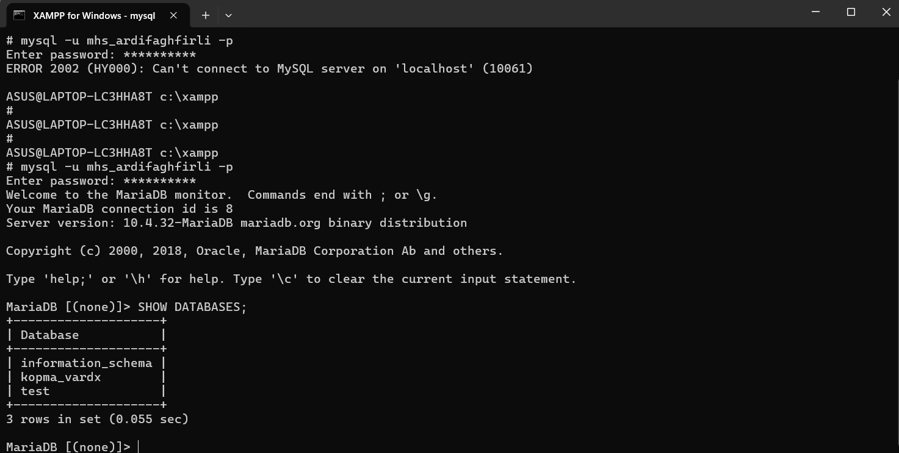
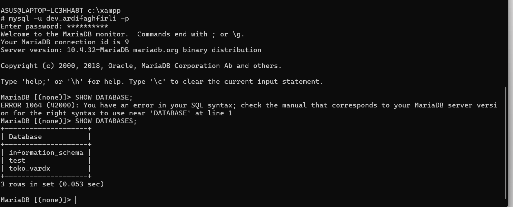

# LAPORAN PRAKTIKUM BASIS DATA
## MODUL 1: DATABASE ENVIRONMENT & PRINCIPLE OF LEAST PRIVILEGE

**Nama**: M Ardi Faghfirli
**NPM**: [25430070] (Akhiran 70 - Tema Akademik)
**Kelas**: Praktikum Basis Data

---

### I. TUJUAN PRAKTIKUM
1. Melakukan konfigurasi lingkungan basis data MariaDB/MySQL pada XAMPP.
2. Membuat database latihan (`kopma_vardx`) dan database proyek mandiri (`toko_vardx`).
3. Menerapkan prinsip *Least Privilege* dengan memisahkan hak akses user sesuai perannya.
4. Memverifikasi isolasi basis data antar akun user.

---

### II. LANGKAH KERJA & DDL SCRIPT

Berikut adalah langkah-langkah SQL yang dieksekusi menggunakan akun `root` MariaDB:

```sql
-- 1. Membuat Database Latihan dan Database Proyek
CREATE DATABASE IF NOT EXISTS kopma_vardx;
CREATE DATABASE IF NOT EXISTS toko_vardx;

-- 2. Membuat User Latihan dan User Developer
CREATE USER IF NOT EXISTS 'mhs_ardifaghfirli'@'localhost' IDENTIFIED BY 'ardialok82';
CREATE USER IF NOT EXISTS 'dev_ardifaghfirli'@'localhost' IDENTIFIED BY 'ardialok82';

-- 3. Mengkonfigurasi Hak Akses (Isolasi Database)
GRANT ALL PRIVILEGES ON kopma_vardx.* TO 'mhs_ardifaghfirli'@'localhost';
GRANT ALL PRIVILEGES ON toko_vardx.* TO 'dev_ardifaghfirli'@'localhost';

-- 4. Memperbarui Hak Akses Sistem
FLUSH PRIVILEGES;

-- 5. Memeriksa Daftar User Terdaftar
SELECT User, Host FROM mysql.user;

 III. HASIL PENGUJIAN DAN PEMBUATAN DATABASE

1. **Pengujian User Latihan (`mhs_ardifaghfirli`)**
   - **Perintah Login**: `mysql -u mhs_ardifaghfirli -p`
   - **Verifikasi**: Menjalankan perintah `SHOW DATABASES;`.
   - **Hasil**: User `mhs_ardifaghfirli` hanya dapat melihat database `kopma_vardx`. Database `toko_vardx` berhasil terisolasi.

   

2. **Pengujian User Developer (`dev_ardifaghfirli`)**
   - **Perintah Login**: `mysql -u dev_ardifaghfirli -p`
   - **Verifikasi**: Menjalankan perintah `SHOW DATABASES;`.
   - **Hasil**: User `dev_ardifaghfirli` hanya dapat melihat database `toko_vardx`. Database `kopma_vardx` berhasil terisolasi.

   

   IV. KESIMPULAN

Pengaturan lingkungan basis data pada Modul 1 telah berhasil 100%. Penerapan prinsip Least Privilege berjalan sesuai ketentuan, di mana masing-masing user hanya memiliki akses penuh pada database yang menjadi wewenangnya tanpa bisa mengintip database milik peran lain.