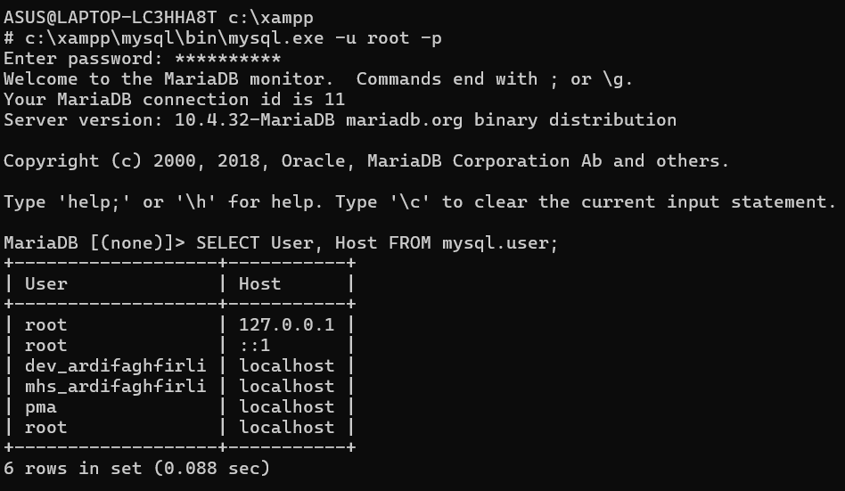
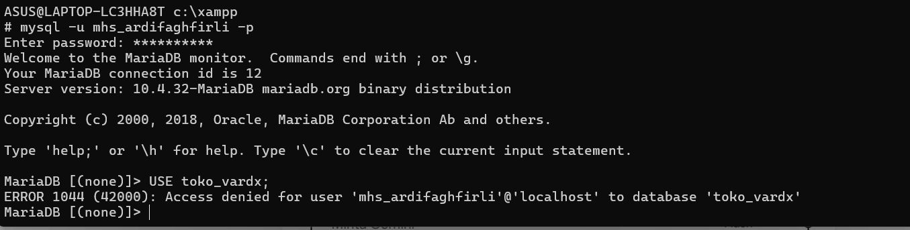
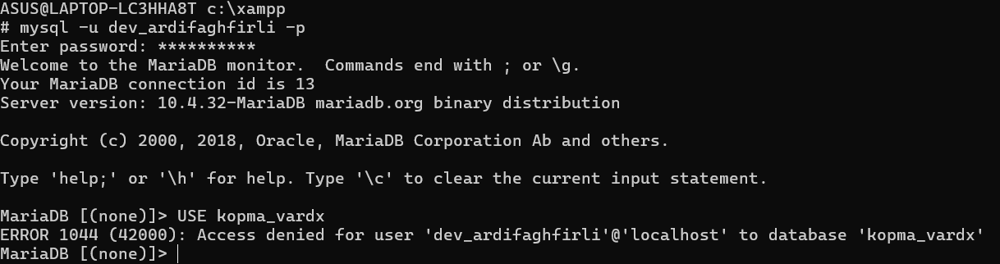

# Laporan Praktikum Basis Data
**Nama:** M Ardi Faghfirli
**NIM:** 25430070
**Kelas:** Praktikum Basis Data
**Pertemuan:** 1
**Tanggal:** 7 Oktober 2026

---

## 1. Tujuan Praktikum
1. Melakukan konfigurasi dan verifikasi lingkungan kerja basis data MariaDB/MySQL pada XAMPP.
2. Menerapkan pemisahan hak akses berbasis prinsip *Least Privilege* dengan membedakan akun administratif dan operasional.
3. Memverifikasi isolasi basis data antar akun serta memahami dampak pembatasan hak akses.
4. Mengelola repositori praktikum menggunakan Git dan GitHub sebagai media publikasi dan dokumentasi.

---

## 2. Ringkasan Dasar Teori
Prinsip *Least Privilege* adalah konsep keamanan di mana setiap pengguna atau proses hanya diberikan hak akses minimal yang benar-benar dibutuhkan untuk menjalankan tugasnya. Dalam pengelolaan MariaDB/MySQL, prinsip ini diterapkan dengan memisahkan akun `root` (super-admin) dari akun operasional. Akun `root` hanya digunakan untuk tugas administratif seperti membuat basis data dan mengelola pengguna. Sementara itu, akun operasional seperti `mhs_070` hanya diberikan akses ke basis data latihan (`kopma_vardx`), dan akun `dev_070` diberikan akses ke basis data proyek mandiri (`toko_vardx`). Pemisahan ini mencegah terjadinya kerusakan sistem secara tak sengaja maupun potensi celah keamanan akibat penggunaan akun privilese tinggi secara sembarangan[cite: 183].

---

## 3. Hasil Langkah Percobaan
Berikut adalah daftar hasil langkah kunci percobaan beserta tangkapan layar terkait[cite: 183]:

1. **Verifikasi Lingkungan Kerja (`SELECT VERSION(), CURRENT_USER();`)**  
     
   *Keterangan:* Memastikan versi MariaDB/MySQL aktif dan mengonfirmasi status login sebagai pengguna `root@localhost`.

2. **Pemeriksaan Mode SQL (`SELECT @@sql_mode;`)**  
     
   *Keterangan:* Menampilkan pengaturan `sql_mode` yang aktif di server MariaDB untuk memastikan aturan sintaksis dan penanganan data berjalan standar.

3. **Verifikasi Hak Akses Akun Mahasiswa (`mhs_070`)**  
     
   *Keterangan:* Menjalankan perintah `SHOW DATABASES;` pada akun `mhs_070`. Terlihat akun ini hanya dapat mengakses basis data `kopma_vardx` dan `information_schema`.

4. **Verifikasi Hak Akses Akun Pengembang (`dev_070`)**  
     
   *Keterangan:* Menjalankan perintah `SHOW DATABASES;` pada akun `dev_070`. Terlihat akun ini hanya memiliki akses terbatas pada basis data `toko_vardx`.

5. **Uji Coba Pembatasan Hak Akses (Galat 1044 / 1142)**  
     
     
   *Keterangan:* Pengujian isolasi basis data saat akun `mhs_070` atau `dev_070` mencoba mengakses basis data yang bukan haknya, sehingga menghasilkan pesan error penolakan akses.

---

## 4. Jawaban Titik Analisis

### Titik Analisis 1: Mengapa akun root tidak boleh digunakan untuk aplikasi harian?
Penggunaan akun `root` untuk aplikasi harian sangat berbahaya karena akun `root` memiliki wewenang penuh (*unrestricted access*) terhadap seluruh server basis data. Jika terjadi kesalahan pada kode aplikasi, serangan *SQL Injection*, atau kebocoran kredensial, penyerang dapat menghapus, mengubah, atau mengambil seluruh data di dalam server.

### Titik Analisis 2: Perbedaan pesan kesalahan SQL (Galat 1044, 1045, dan 1142)
- **Galat 1045 (Access Denied - Authentication):** Terjadi di tingkat autentikasi, yaitu ketika pengguna gagal melakukan login akibat kesalahan nama pengguna (*username*), kata sandi (*password*), atau lokasi host (*localhost*).
- **Galat 1044 (Access Denied - Database Level):** Terjadi setelah login berhasil, namun pengguna mencoba melakukan operasi atau memilih basis data (`USE <database>`) yang tidak terdaftar dalam hak aksesnya.
- **Galat 1142 (Command Denied - Table/Column Level):** Terjadi ketika pengguna berhasil terhubung ke basis data, tetapi tidak memiliki izin untuk menjalankan perintah spesifik (seperti `SELECT`, `INSERT`, `DROP`) pada tabel tertentu.

### Titik Analisis 3: Konsekuesi pemberian hak akses `ALL PRIVILEGES` dengan wildcard (`*.*`)
Memberikan hak akses `ALL PRIVILEGES ON *.*` kepada akun pengguna biasa membatalkan penerapan prinsip *Least Privilege*. Pengguna tersebut memiliki wewenang yang hampir setara dengan `root`, sehingga risiko hilangnya data, manipulasi struktur basis data secara tidak sah, atau kebocoran data antar-aplikasi menjadi sangat tinggi[cite: 183, 184].

### Titik Analisis 4: Mengapa isolasi basis data antar pengguna itu penting?
Isolasi basis data memastikan bahwa setiap pengguna atau lingkungan (*environment*) hanya dapat melihat dan mengelola data yang menjadi wewenangnya. Hal ini mencegah terjadinya *cross-database contamination* atau kerusakan yang meluas jika salah satu akun pengguna terkompromi[cite: 183, 184].

---

## 5. Hasil Latihan dan Modifikasi
Skrip pembuatan basis data dan alokasi hak akses pengguna disimpan pada berkas `p01_lingkungan_25430070.sql`. Berikut adalah cuplikan perintah SQL utama yang dieksekusi:

```sql
-- 1. Membuat Database Latihan dan Proyek Mandiri
CREATE DATABASE IF NOT EXISTS kopma_vardx;
CREATE DATABASE IF NOT EXISTS toko_vardx;

-- 2. Membuat User dan Mengatur Hak Akses (Prinsip Least Privilege)
CREATE USER IF NOT EXISTS 'mhs_070'@'localhost' IDENTIFIED BY '<password_kerja>';
GRANT ALL PRIVILEGES ON kopma_vardx.* TO 'mhs_070'@'localhost';

CREATE USER IF NOT EXISTS 'dev_070'@'localhost' IDENTIFIED BY '<password_kerja>';
GRANT ALL PRIVILEGES ON toko_vardx.* TO 'dev_070'@'localhost';

FLUSH PRIVILEGES;

---

## 6. Tugas Mandiri: Milestone Proyek 1
1. **Inisialisasi Basis Data Proyek:** Telah dibuat basis data `toko_vardx` sebagai fondasi penyimpanan data proyek mandiri[cite: 183].
2. **Konfigurasi Akun Pengembang:** Dibuat akun pengguna `dev_070` yang dikhususkan hanya untuk mengelola basis data `toko_vardx`[cite: 183].
3. **Penyusunan Dokumentasi Utama (README.md):** Berkas `README.md` pada akar repositori telah diperbarui dengan Identitas Proyek, deskripsi singkat tema akademik/bisnis, serta konfigurasi `.gitignore` untuk mengabaikan berkas sensitif[cite: 183, 184].

---

## 7. Pembahasan dan Kendala
- **Kendala:** Saat pengujian login phpMyAdmin menggunakan akun pengguna non-root (`mhs_070`), terjadi kegagalan akses otomatis karena phpMyAdmin default XAMPP menggunakan mode autentikasi `config` dengan akun `root` tanpa kata sandi.
- **Cara Mengatasi:** Melakukan penyesuaian konfigurasi pada berkas `config.inc.php` di folder phpMyAdmin dengan mengubah `$cfg['Servers'][$i]['auth_type'] = 'cookie';` agar muncul form login interaktif[cite: 184].
- **Kendala Galat SQL:** Menemui galat `ERROR 1044 (42000)` saat akun `mhs_070` mencoba mengakses database `toko_vardx`. Dari pembacaan pesan galat, dipahami bahwa hal ini sesuai dengan ekspektasi konfigurasi prinsip *Least Privilege* di mana pembatasan hak akses berhasil diterapkan[cite: 184].

---

## 8. Kesimpulan
1. Konfigurasi lingkungan kerja basis data MariaDB/MySQL telah berhasil dilakukan dan diverifikasi[cite: 183].
2. Penerapan prinsip *Least Privilege* terbukti dapat mengisolasi basis data antar akun pengguna, sehingga meningkatkan keamanan sistem secara keseluruhan[cite: 183].
3. Penggunaan repositori Git dan GitHub memudahkan dokumentasi seluruh aktivitas praktikum secara terstruktur dan dapat dilacak[cite: 183].

---

## 9. Pernyataan Penggunaan AI
Penggunaan alat bantu AI (Gemini) pada praktikum ini digunakan untuk:
1. Membantu memberikan petunjuk tata cara penyusunan struktur laporan Markdown sesuai dengan panduan praktikum[cite: 183].
2. Membantu melakukan analisis dan penjelasan teoritis mengenai perbedaan kode galat MariaDB/MySQL (1044, 1045, 1142)[cite: 184].


---

## 10. Bukti Git
- **Tautan Repositori GitHub:** `https://github.com/MARDIFAGHFIRLI/basis_data`[cite: 307]
- **Hash Commit Pertemuan 1:** `8dec2a89ac237f23e518c2da2f47b2aefcc499fa`[cite: 307]

---

## Checklist
- [x] Berkas `p01_laporan_25430070.sql` dapat dijalankan ulang[cite: 184]
- [x] Berkas `README.md` berisi Identitas Proyek dan `.gitignore`[cite: 184]
- [x] Tangkapan layar `SELECT VERSION(), CURRENT_USER();`[cite: 184]
- [x] Tangkapan layar `SELECT @@sql_mode;`[cite: 184]
- [x] Tangkapan layar `SHOW DATABASES` sebagai `mhs_070` dan `dev_070`[cite: 184]
- [x] Tangkapan layar galat `1044` dan `1142`[cite: 184]
- [x] Tangkapan layar halaman masuk phpMyAdmin mode cookie[cite: 184]
- [x] Tangkapan layar `git push` pertama[cite: 184]
- [x] Analisis Titik Analisis 1-4 dan perbedaan kode galat 1044, 1045, serta 1142[cite: 184]