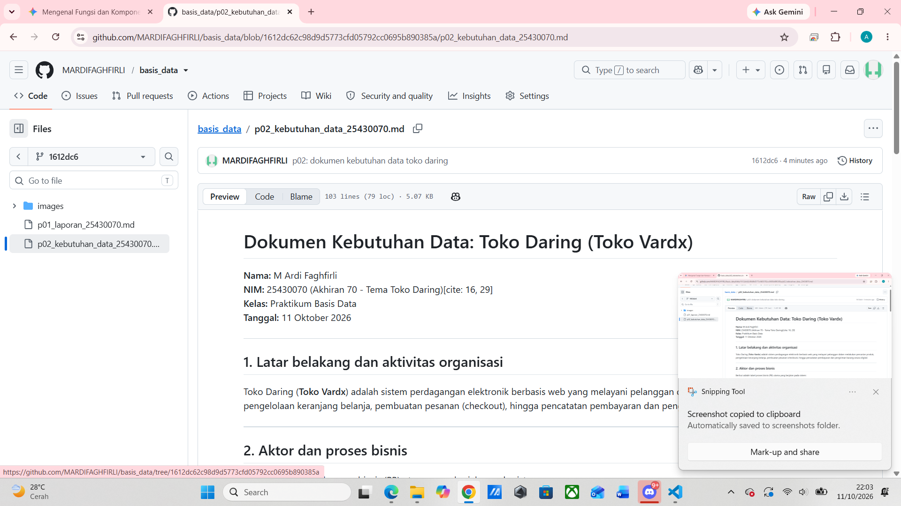

# Laporan Praktikum Basis Data

**Nama:** M Ardi Faghfirli  
**NIM:** 25430070  
**Kelas:** Praktikum Basis Data  
**Pertemuan:** 2  
**Tanggal:** 8 Oktober 2026  

## 1. Tujuan Praktikum
Mengidentifikasi aktivitas organisasi, aktor, proses bisnis, elemen data, aturan bisnis, matriks CRUD, serta kamus data awal untuk proyek Toko Daring.

## 2. Ringkasan Dasar Teori
Analisis kebutuhan data merupakan tahap awal dalam siklus perancangan basis data sebelum melangkah ke tahap desain konseptual (ERD), logis, dan fisik. Analisis kebutuhan berfungsi menterjemahkan proses bisnis menjadi aset data yang jelas aturan mainnya dan memiliki tata kelola yang baik.

## 3. Hasil Langkah Percobaan
Telah dibuat berkas `p02_kebutuhan_data_25430070.md` di repositori GitHub `basis_data` yang berisi analisis lengkap proyek Toko Daring dengan parameter $P = 8$.

## 4. Hasil Tangkapan Layar Tampilan GitHub
Berikut adalah bukti tampilan berkas dokumen kebutuhan data pada web GitHub:

  
*Keterangan: Tampilan berkas `p02_kebutuhan_data_25430070.md` di repositori GitHub.*

## 5. Pembahasan dan Kendala
Proses penyusunan dokumen p02 berjalan lancar. Parameter $P = 8$ yang diperoleh dari $(70 \bmod 9) + 1$ diterapkan untuk menentukan batasan maksimal item per transaksi ($P + 2 = 10$) dan estimasi volume transaksi harian.

## 6. Kesimpulan
Dokumen analisis kebutuhan data untuk Toko Daring telah diselesaikan sesuai format standar modul dan telah ter-push ke GitHub.

## 7. Pernyataan Penggunaan AI
Menggunakan asisten AI untuk membantu pemahaman kerangka dokumen analisis kebutuhan data

## 8. Bukti Git
- Tautan Repositori: `https://github.com/MARDIFAGHFIRLI/basis_data`
- Pesan Commit: `p02: dokumen kebutuhan data toko daring`

## Checklist
- [x] Berkas `p02_kebutuhan_data_25430070.md` di repositori
- [x] Bukti tangkapan layar tampilan GitHub terlampir di laporan
- [x] Tabel PB, AB, KI, Matriks CRUD, dan Kamus Data lengkap