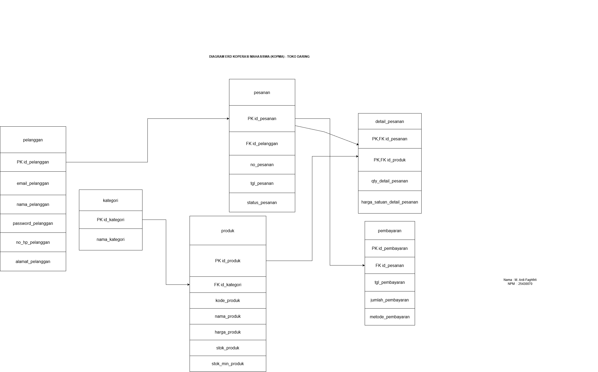

# Laporan Praktikum Basis Data - Pertemuan 03
**Nama:** M. Ardi Faghfirli  **NPM:** 25430070  **Kelas:** C   **Tanggal:** 11 Oktober 2026

---

## 1. Tujuan Praktikum
1. Mampu merancang *Entity Relationship Diagram* (ERD) untuk pemodelan data basis data konseptual toko daring.
2. Mampu memetakan entitas dan atribut sesuai dengan Proses Bisnis (PB) dan Kebutuhan Informasi (KI) yang telah ditentukan.
3. Mampu menentukan *Primary Key* (PK), *Foreign Key* (FK), serta kardinalitas relasi antar entitas secara tepat.
4. Memenuhi standar keaslian dokumen praktikum (menyertakan judul organisasi KOPMA dan tanda tangan digital Nama/NIM pada diagram).

---

## 2. Ringkasan Dasar Teori
- **Entity Relationship Diagram (ERD):** Diagram konseptual yang menggambarkan struktur basis data, hubungan antar data, beserta batasan-batasannya.
- **Entitas & Atribut:** Entitas mewakili objek di dunia nyata (tabel), sedangkan atribut menggambarkan karakteristik/properti dari entitas tersebut.
- **Kunci (Primary Key & Foreign Key):**
  - *Primary Key (PK):* Atribut unik yang menjadi pembeda utama setiap baris dalam entitas.
  - *Foreign Key (FK):* Atribut yang merujuk pada PK di entitas lain untuk membentuk relasi antar tabel.
- **Kardinalitas Relasi:** Aturan hubungan data antar entitas, seperti *One-to-Many* (1:N) dan *One-to-One* (1:1).
- **Entitas Asosiatif (Junction Table):** Tabel pembantu yang digunakan untuk memecah relasi *Many-to-Many* (M:N) menjadi dua relasi *One-to-Many* (1:N).

---

## 3. Hasil Langkah Percobaan
Berikut adalah bukti perancangan diagram ERD yang dilakukan pada platform `draw.io` beserta tangkapan layarnya:

*Keterangan Gambar:*
Diagram ERD Toko Daring KOPMA dirancang menggunakan notasi *Crow's Foot*. Pada kanvas diagram telah disertakan Judul Organisasi (`DIAGRAM ERD KOPERASI MAHASISWA (KOPMA) - TOKO DARING`) di bagian atas serta Tanda Tangan Digital (`Nama: M. Ardi Faqihri` & `NIM: 25430070`) di sudut kanan bawah sesuai aturan keaslian berkas.

---

## 4. Jawaban Titik Analisis

### 4.1 Pemetaan Entitas ke Kebutuhan Informasi (PB/KI)
| Entitas | Pemetaan PB / KI | Struktur Atribut & Kunci |
| :--- | :--- | :--- |
| **`pelanggan`** | **KI-01:** Pengelolaan data akun dan profil pengguna | `PK id_pelanggan`, `email_pelanggan`, `nama_pelanggan`, `password_pelanggan`, `no_hp_pelanggan`, `alamat_pelanggan` |
| **`kategori`** | **KI-02:** Pengelompokan jenis katalog barang toko | `PK id_kategori`, `nama_kategori` |
| **`produk`** | **KI-03:** Manajemen inventaris stok dan harga barang | `PK id_produk`, `FK id_kategori`, `kode_produk`, `nama_produk`, `harga_produk`, `stok_produk`, `stok_min_produk` |
| **`pesanan`** | **PB-01:** Pencatatan transaksi belanja pelanggan | `PK id_pesanan`, `FK id_pelanggan`, `no_pesanan`, `tgl_pesanan`, `status_pesanan` |
| **`detail_pesanan`** | **PB-02:** Rincian item barang yang dibeli per transaksi | `PK,FK id_pesanan`, `PK,FK id_produk`, `qty_detail_pesanan`, `harga_satuan_detail_pesanan` |
| **`pembayaran`** | **PB-03:** Verifikasi dan konfirmasi pembayaran pesanan | `PK id_pembayaran`, `FK id_pesanan`, `tgl_pembayaran`, `jumlah_pembayaran`, `metode_pembayaran` |

### 4.2 Analisis Kardinalitas Relasi Utama
1. **`kategori` ➔ `produk` (1:N):** Satu kategori dapat membawahi banyak produk, namun satu produk hanya memiliki satu kategori utama (`PK id_kategori` ke `FK id_kategori`).
2. **`pelanggan` ➔ `pesanan` (1:N):** Satu pelanggan dapat melakukan banyak pesanan, namun satu pesanan hanya dimiliki oleh satu pelanggan (`PK id_pelanggan` ke `FK id_pelanggan`).
3. **`pesanan` ➔ `detail_pesanan` (1:N):** Satu transaksi pesanan dapat mencakup beberapa item barang (`PK id_pesanan` ke `PK,FK id_pesanan`).
4. **`produk` ➔ `detail_pesanan` (1:N):** Satu produk dapat dipesan dalam banyak rincian transaksi (`PK id_produk` ke `PK,FK id_produk`).
5. **`pesanan` ➔ `pembayaran` (1:1):** Satu transaksi pesanan hanya terhubung ke satu catatan verifikasi pembayaran (`PK id_pesanan` ke `FK id_pesanan`).

---

## 5. Hasil Latihan dan Modifikasi
- Membentuk entitas asosiatif `detail_pesanan` dengan kombinasi `PK,FK id_pesanan` dan `PK,FK id_produk` guna menyelesaikan masalah relasi *Many-to-Many* (M:N) antara entitas `produk` dan `pesanan`.
- Menambahkan atribut penunjang seperti `stok_min_produk` pada entitas `produk` untuk keperluan peringatan dini (*warning*) batas minimum stok barang.

---

## 6. Tugas Mandiri: Milestone Proyek 03
- **Topik Proyek:** Toko Daring Koperasi Mahasiswa (KOPMA).
- **Capaian Milestone:**
  1. Menyelesaikan perancangan 6 entitas utama basis data konseptual.
  2. Memastikan seluruh entitas saling terhubung melalui relasi kunci PK-FK secara konsisten tanpa ada entitas terisolasi (*orphan*).
  3. Menyimpan file sumber diagram `.drawio` di direktori proyek dan mengekspor gambar `.png` ke folder `images/`.

---

## 7. Pembahasan dan Kendala
- **Pembahasan:** Pemodelan ERD berhasil memetakan seluruh alur bisnis dari pendaftaran pelanggan, pemilihan kategori/produk, pemrosesan pesanan, hingga konfirmasi pembayaran.
- **Kendala & Solusi:**
  - *Kendala:* Menggabungkan relasi antara produk dan pesanan yang bersifat M:N.
  - *Solusi:* Dibuat entitas asosiatif `detail_pesanan` yang menyimpan kuantitas (`qty_detail_pesanan`) dan harga saat transaksi dilakukan (`harga_satuan_detail_pesanan`).

---

## 8. Kesimpulan
Perancangan ERD Toko Daring KOPMA telah selesai dikerjakan sesuai aturan normalisasi basis data dan petunjuk checklist praktikum. Struktur relasi antar entitas telah divalidasi dan siap untuk ditransformasikan ke tahap pembuatan skema tabel DDL (SQL) pada modul selanjutnya.

---

## 9. Pernyataan Penggunaan AI
saya pake ai(gemini) untuk menjelaskan dan kasih langkah langkahnya untuk mengerjakan modoul ini dan untuk koreksi apakah diagram saya sudah benar atau belum

---

## 10. Bukti Git
- **Tautan Repositori:** `https://github.com/username/basis-data` *(Ganti dengan link repo milikmu)*
- **Hash Commit:** `a1b2c3d4e5f67890` *(Ganti dengan hash commit git kamu)*

---

## Checklist
- [x] Berkas laporan disimpan di `laporan/p03_laporan_25430070.md`
- [x] Berkas sumber diagram (`.drawio`) dan gambar (`.png`) sudah lengkap
- [x] Terdapat Judul Organisasi KOPMA pada diagram ERD
- [x] Terdapat Tanda Tangan Digital (Nama & NIM) pada diagram ERD
- [x] Seluruh entitas terhubung dengan kardinalitas yang terbaca jelas