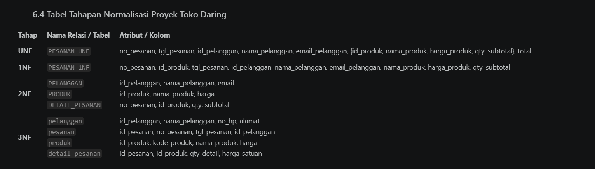

# Laporan Praktikum Basis Data - Pertemuan 04: Normalisasi dan Skema Relasional
**Nama:** M Ardi Faghfirli  
**NIM:** 25430070 (Akhiran 70 - Tema Toko Daring)  
**Kelas:** C  
**Tanggal:** 17 Oktober 2026  

---

## 1. Tujuan Praktikum
1. Mengambil dokumen sumber proyek dari Pertemuan 2 (Toko Daring / Toko Vardx) sebagai titik awal *Un-Normalized Form* (UNF).
2. Menuliskan ketergantungan fungsional (*Functional Dependencies*) beserta kode aturan bisnis (`AB-xx`) yang mendasarinya.
3. Menunjukkan tahapan normalisasi dari 1NF, 2NF, 3NF, hingga hasil pemeriksaan BCNF.
4. Memutuskan penyimpanan setiap nilai turunan beserta alasannya.

---

## 2. Ringkasan Dasar Teori
- **Normalisasi:** Proses pengorganisasian data ke dalam tabel-tabel untuk menghilangkan redundansi data dan mencegah anomali basis data (anomali ubah, sisip, dan hapus).
- **Dependensi Fungsional (FD):** Aturan di mana nilai suatu atribut secara unik menentukan nilai atribut lainnya berdasarkan logika proses bisnis organisasi.
- **Bentuk Normal (1NF, 2NF, 3NF, BCNF):** Tingkatan normalisasi yang memastikan atomisitas data, ketiadaan ketergantungan parsial, dan ketiadaan ketergantungan transitif.

---

## 3. Hasil Langkah Percobaan
Analisis normalisasi pada kasus standar Koperasi Mahasiswa (Kopma) telah dipelajari sebagai acuan pemecahan struktur tabel relasional dari dokumen mentah hingga menjadi skema kanonik 3NF yang bersih.

---

## 4. Jawaban Titik Analisis
- **Titik Analisis 1:** Harga satuan pada detail pesanan ditempatkan pada kunci komposit tabel transaksi agar catatan historis harga masa lalu tidak berubah ketika harga produk diubah pada tabel master.
- **Titik Analisis 2:** Nilai total pesanan tidak disimpan di tabel operasional utama untuk menghindari anomali *update* dan ketidakkonsistenan data, melainkan dihitung secara dinamis saat kueri dijalankan.
- **Titik Analisis 3:** Informasi pemasok dihubungkan melalui riwayat tabel pembelian/detail pembelian, sehingga toko daring dapat mengubah pemasok tanpa merusak tabel master produk.

---

## 5. Hasil Latihan dan Modifikasi
Melakukan simulasi pemisahan atribut multi-nilai dan memeriksa anomali ubah apabila atribut non-kunci diletakkan di tempat yang salah.

---

## 6. Tugas Mandiri: Milestone Proyek 04 (Toko Daring - Toko Vardx)

### 6.1 Dokumen Sumber & Bentuk Tidak Normal (UNF)
Mengambil acuan dari dokumen sumber pesanan/checkout Toko Vardx (Pertemuan 2), dibentuk tabel mentah gabungan (*UNF*):
`PESANAN_UNF (no_pesanan, tgl_pesanan, id_pelanggan, nama_pelanggan, email_pelanggan, no_hp_pelanggan, alamat_pelanggan, { id_produk, kode_produk, nama_produk, harga_produk, qty_detail, harga_satuan_detail }, total_pesanan, status_pesanan)`

### 6.2 Ketergantungan Fungsional (Functional Dependencies)
Berdasarkan Aturan Bisnis (`AB-01` s.d. `AB-06`) dari dokumen kebutuhan data Toko Vardx:
* **FD1:** `no_pesanan -> tgl_pesanan, id_pelanggan, status_pesanan` *(Berdasarkan AB-01)*
* **FD2:** `id_pelanggan -> nama_pelanggan, email_pelanggan, no_hp_pelanggan, alamat_pelanggan` *(Berdasarkan AB-05)*
* **FD3:** `id_produk -> kode_produk, nama_produk, harga_produk, stok_produk`
* **FD4:** `(no_pesanan, id_produk) -> qty_detail, harga_satuan_detail` *(Berdasarkan AB-04)*

### 6.3 Tahapan Normalisasi (1NF, 2NF, 3NF) & BCNF
1. **1NF (First Normal Form):**  
   Menghilangkan grup berulang `{ ... }` pada rincian produk. Kolom atribut produk dipisahkan dan kunci primer diubah menjadi kunci komposit: `(no_pesanan, id_produk)`.
2. **2NF (Second Normal Form):**  
   Menghilangkan ketergantungan parsial. Atribut yang hanya bergantung pada sebagian kunci komposit dipisah ke tabel induknya masing-masing (`pelanggan` dan `produk`).
3. **3NF (Third Normal Form):**  
   Menghilangkan ketergantungan transitif. Hasil akhir membentuk struktur 4 tabel relasional utama yang bersih:
   - **`pelanggan`** (PK: `id_pelanggan`, Atribut: `email_pelanggan`, `nama_pelanggan`, `no_hp_pelanggan`, `alamat_pelanggan`)
   - **`pesanan`** (PK: `id_pesanan`, FK: `id_pelanggan`, Atribut: `no_pesanan`, `tgl_pesanan`, `status_pesanan`)
   - **`produk`** (PK: `id_produk`, Atribut: `kode_produk`, `nama_produk`, `harga_produk`, `stok_produk`)
   - **`detail_pesanan`** (PK,FK: `id_pesanan`, PK,FK: `id_produk`, Atribut: `qty_detail_pesanan`, `harga_satuan_detail_pesanan`)
4. **Pemeriksaan BCNF:**  
   Setiap penentu (*determinant*) pada skema di atas terbukti merupakan kunci kandidat (*candidate key*), sehingga seluruh tabel telah memenuhi syarat BCNF.
   
   ### 6.4 Tabel Tahapan Normalisasi Proyek Toko Daring
| Tahap | Nama Relasi / Tabel | Atribut / Kolom |
| :--- | :--- | :--- |
| **UNF** | `PESANAN_UNF` | no_pesanan, tgl_pesanan, id_pelanggan, nama_pelanggan, email_pelanggan, {id_produk, nama_produk, harga_produk, qty, subtotal}, total |
| **1NF** | `PESANAN_1NF` | no_pesanan, id_produk, tgl_pesanan, id_pelanggan, nama_pelanggan, email_pelanggan, nama_produk, harga_produk, qty, subtotal |
| **2NF** | `PELANGGAN` `PRODUK` `DETAIL_PESANAN` | id_pelanggan, nama_pelanggan, email id_produk, nama_produk, harga no_pesanan, id_produk, qty, subtotal |
| **3NF** | `pelanggan` `pesanan` `produk` `detail_pesanan` | id_pelanggan, nama_pelanggan, no_hp, alamat id_pesanan, no_pesanan, tgl_pesanan, id_pelanggan id_produk, kode_produk, nama_produk, harga id_pesanan, id_produk, qty_detail, harga_satuan |

### 6.5 Keputusan Nilai Turunan
- **Atribut Turunan:** `subtotal_pesanan` dan `total_biaya`.
- **Keputusan:** **Tidak disimpan** di dalam tabel operasional utama.
- **Alasan:** Nilai dapat dihitung secara akurat kapan saja melalui operasi perkalian `qty_detail * harga_satuan_detail` pada kueri SQL, sehingga konsistensi data tetap terjaga apabila terjadi perubahan kuantitas atau harga di masa mendatang.

---

## 7. Pembahasan dan Kendala
- **Pembahasan:** Transformasi dari dokumen UNF Toko Vardx berhasil diselesaikan secara runtut hingga level 3NF dan BCNF, menghasilkan model data relasional yang bebas anomali.
- **Kendala & Solusi:** Sempat terkendala dalam memetakan atribut harga pada tabel detail transaksi. Diselesaikan dengan merujuk langsung pada aturan bisnis `AB-04` untuk menyimpan harga snapshot saat transaksi.

---

## 8. Kesimpulan
Modul 4 berhasil diselesaikan dengan baik. Seluruh entitas dan relasi dari proyek Toko Daring (Toko Vardx) kini telah tervalidasi melalui normalisasi dan siap dilanjutkan ke tahap perancangan struktur fisik basis data (DDL) pada Pertemuan 5.

---

## 9. Pernyataan Penggunaan AI
Saya menyatakan bahwa dalam penyusunan analisis normalisasi skema relasional ini, saya menggunakan bantuan alat AI (Gemini) untuk berdiskusi terkait perumusan dependensi fungsional dan penataan struktur format Markdown. Seluruh proses peninjauan dan penyesuaian akhir dilakukan secara mandiri.

---

## 10. Bukti Git
- **Tautan Repositori:** `https://github.com/MARDIFAGHFIRLI/basis_data`
- **Hash Commit:** `p04: menyelesaikan dokumen normalisasi dan skema relasional 3nf toko daring`

---

## Checklist
- [x] Mengambil dokumen sumber proyek dari Pertemuan 2 sebagai titik awal UNF
- [x] Menuliskan dependensi fungsional beserta kode aturan bisnis (`AB-xx`)
- [x] Menunjukkan tahapan 1NF, 2NF, 3NF, dan hasil pemeriksaan BCNF
- [x] Memutuskan penyimpanan setiap nilai turunan beserta alasannya
- [x] Menyertakan Pernyataan Penggunaan AI dan Bukti Git