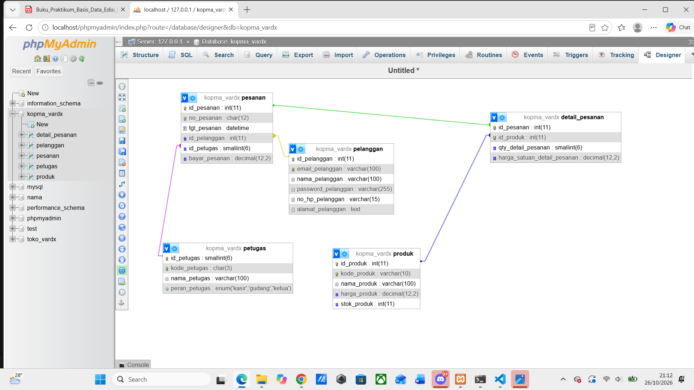
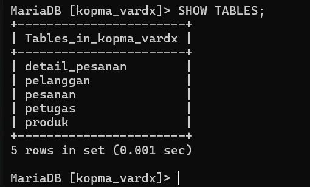

# Laporan Praktikum Basis Data - Pertemuan 05
**Nama:** M. Ardi Faghfirli  
**NIM:** 25430070  
**Kelas:** C  
**Tanggal:** 26 Oktober 2026

---

## 1. Tujuan Praktikum
1. Menulis skrip `p05_ddl_25430070.sql` untuk seluruh tabel proyek yang dapat dijalankan ulang dari basis data kosong.
2. Menerapkan kunci primer, kunci tamu (relasi ERD), serta *constraint* dan komentar kode aturan bisnis (`AB-xx`).
3. Menganalisis aturan batas P + 2 dari Modul 2 serta mendokumentasikan ERD fisik dan pemetaan tipe data.

---

## 2. Ringkasan Dasar Teori
- **DDL (Data Definition Language):** Perintah SQL untuk mendefinisikan struktur basis data (`CREATE TABLE`, `DROP TABLE`).
- **Constraint & Aturan Bisnis:** Batasan integritas data seperti `PRIMARY KEY`, `FOREIGN KEY`, `UNIQUE`, `CHECK`, dan `ENUM` yang merepresentasikan aturan bisnis (`AB-xx`).
- **ERD Fisik:** Rancangan skema basis data tingkat lanjut yang memuat nama tabel, kolom, tipe data, ukuran, serta relasi kunci tamu secara presisi.

---

## 3. Analisis Aturan Batas (P + 2)
- Berdasarkan analisis dari Modul 2, validasi yang menyangkut satu baris data (seperti `qty` per item atau batasan harga/stok $\ge 0$) diwujudkan menggunakan **`CHECK`**.
- Validasi yang menyangkut jumlah agregasi baris per transaksi (misalnya batasan total item atau aturan multi-baris) tidak dapat dijaga hanya dengan `CHECK` baris tunggal, sehingga dicatat untuk diselesaikan pada Modul 14.

---

## 4. Pemetaan Tipe Data dan Struktur Tabel

Berikut adalah ringkasan pemetaan tipe data untuk proyek Toko Daring (Toko Vardx):

| No | Nama Tabel | Kolom | Tipe Data & Ukuran | Constraint / Keterangan |
|----|------------|-------|--------------------|-------------------------|
| 1 | `pelanggan` | `id_pelanggan` | INT | PK, Auto Increment |
| | | `email_pelanggan` | VARCHAR(100) | NOT NULL, UNIQUE |
| 2 | `produk` | `id_produk` | INT | PK, Auto Increment |
| | | `kode_produk` | VARCHAR(10) | NOT NULL, UNIQUE |
| | | `harga_produk` | DECIMAL(12,2) | NOT NULL, CHECK ($\ge 0$) |
| | | `stok_produk` | INT | NOT NULL, DEFAULT 0, CHECK ($\ge 0$) |
| 3 | `petugas` | `id_petugas` | SMALLINT | PK, Auto Increment |
| | | `peran_petugas` | ENUM | 'kasir', 'gudang', 'ketua' |
| 4 | `pesanan` | `id_pesanan` | INT | PK, Auto Increment |
| | | `no_pesanan` | CHAR(12) | NOT NULL, UNIQUE |
| | | `id_pelanggan` | INT | FK ke `pelanggan` |
| | | `id_petugas` | SMALLINT | FK ke `petugas` |
| 5 | `detail_pesanan`| `id_pesanan` | INT | PK (Komposit), FK ke `pesanan` (CASCADE) |
| | | `id_produk` | INT | PK (Komposit), FK ke `produk` |
| | | `qty_detail_pesanan`| SMALLINT | NOT NULL, CHECK ($> 0$) |

---

## 5. Tugas Mandiri: Milestone Proyek 05

### 5.1 Skrip Implementasi DDL (`p05_ddl_25430070.sql`)
```sql
USE kopma_vardx;

-- Hapus tabel dari anak ke induk jika sudah ada sebelumnya
DROP TABLE IF EXISTS detail_pesanan;
DROP TABLE IF EXISTS pesanan;
DROP TABLE IF EXISTS produk;
DROP TABLE IF EXISTS petugas;
DROP TABLE IF EXISTS pelanggan;

-- 1. Tabel pelanggan (Master) [AB-01]
CREATE TABLE pelanggan (
    id_pelanggan INT NOT NULL AUTO_INCREMENT,
    email_pelanggan VARCHAR(100) NOT NULL,
    nama_pelanggan VARCHAR(100) NOT NULL,
    password_pelanggan VARCHAR(255) NOT NULL,
    no_hp_pelanggan VARCHAR(15) NULL,
    alamat_pelanggan TEXT NULL,
    PRIMARY KEY (id_pelanggan),
    UNIQUE KEY uq_pelanggan_email (email_pelanggan)
) ENGINE=InnoDB;

-- 2. Tabel produk (Master) [AB-02]
CREATE TABLE produk (
    id_produk INT NOT NULL AUTO_INCREMENT,
    kode_produk VARCHAR(10) NOT NULL,
    nama_produk VARCHAR(100) NOT NULL,
    harga_produk DECIMAL(12,2) NOT NULL,
    stok_produk INT NOT NULL DEFAULT 0,
    PRIMARY KEY (id_produk),
    UNIQUE KEY uq_produk_kode (kode_produk),
    CONSTRAINT ck_produk_harga CHECK (harga_produk >= 0),
    CONSTRAINT ck_produk_stok CHECK (stok_produk >= 0)
) ENGINE=InnoDB;

-- 3. Tabel petugas (Master) [AB-03]
CREATE TABLE petugas (
    id_petugas SMALLINT NOT NULL AUTO_INCREMENT,
    kode_petugas CHAR(3) NOT NULL,
    nama_petugas VARCHAR(100) NOT NULL,
    peran_petugas ENUM('kasir', 'gudang', 'ketua') NOT NULL,
    PRIMARY KEY (id_petugas),
    UNIQUE KEY uq_petugas_kode (kode_petugas)
) ENGINE=InnoDB;

-- 4. Tabel pesanan (Transaksi) [AB-04]
CREATE TABLE pesanan (
    id_pesanan INT NOT NULL AUTO_INCREMENT,
    no_pesanan CHAR(12) NOT NULL,
    tgl_pesanan DATETIME NOT NULL,
    id_pelanggan INT NOT NULL,
    id_petugas SMALLINT NOT NULL,
    bayar_pesanan DECIMAL(12,2) NOT NULL,
    PRIMARY KEY (id_pesanan),
    UNIQUE KEY uq_pesanan_no (no_pesanan),
    CONSTRAINT fk_pesanan_pelanggan FOREIGN KEY (id_pelanggan) REFERENCES pelanggan (id_pelanggan),
    CONSTRAINT fk_pesanan_petugas FOREIGN KEY (id_petugas) REFERENCES petugas (id_petugas)
) ENGINE=InnoDB;

-- 5. Tabel detail_pesanan (Relasi / Anak) [AB-05]
CREATE TABLE detail_pesanan (
    id_pesanan INT NOT NULL,
    id_produk INT NOT NULL,
    qty_detail_pesanan SMALLINT NOT NULL,
    harga_satuan_detail_pesanan DECIMAL(12,2) NOT NULL,
    PRIMARY KEY (id_pesanan, id_produk),
    CONSTRAINT fk_detail_pesanan FOREIGN KEY (id_pesanan) REFERENCES pesanan (id_pesanan) ON DELETE CASCADE,
    CONSTRAINT fk_detail_produk FOREIGN KEY (id_produk) REFERENCES produk (id_produk),
    CONSTRAINT ck_detail_qty CHECK (qty_detail_pesanan > 0)
) ENGINE=InnoDB;
```

### 5.2 ERD Fisik Proyek (`p05_erd_fisik_25430070.png`)
Berikut adalah gambar ERD fisik yang merelasikan seluruh tabel master, transaksi, dan kunci tamu sesuai standar kelengkapan:



---

## 6. Bukti Eksekusi & Hasil Pengujian

* **Daftar Tabel MariaDB (`SHOW TABLES;`):**
  

---

## 7. Pembahasan dan Kendala
- **Pembahasan:** Seluruh tabel berhasil dirancang, diuji coba melalui skrip DDL, dan direlasikan ke dalam bentuk ERD fisik yang komprehensif.
- **Kendala & Solusi:**
  - *Kendala:* Penyesuaian relasi kunci tamu pada tabel berelasi banyak (*many-to-many*).
  - *Solusi:* Menerapkan tabel perantara `detail_pesanan` dengan kunci primer komposit.

---

## 8. Kesimpulan
Modul 5 berhasil diselesaikan dengan menyusun skrip DDL yang reusable, menerapkan *constraint* berdasarkan aturan bisnis, menganalisis batas P + 2, serta melampirkan dokumentasi ERD fisik beserta pemetaan tipe datanya.

---

## 9. Pernyataan Penggunaan AI
Saya menyatakan bahwa dalam penyusunan dokumentasi dan perumusan laporan praktikum ini, saya menggunakan bantuan alat AI (Gemini) sebagai media diskusi untuk memvalidasi struktur DDL, format Markdown, dan kelengkapan tugas mandiri. Seluruh hasil akhir diperiksa dan disesuaikan secara mandiri.

---

## 10. Bukti Git
- **Tautan Repositori:** `https://github.com/MARDIFAGHFIRLI/basis_data`
- **Hash Commit:** `p05: ddl, erd fisik, dan laporan modul 5`