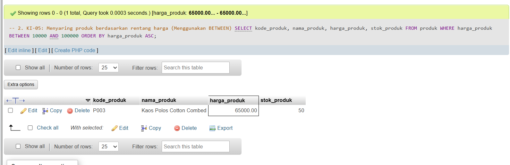
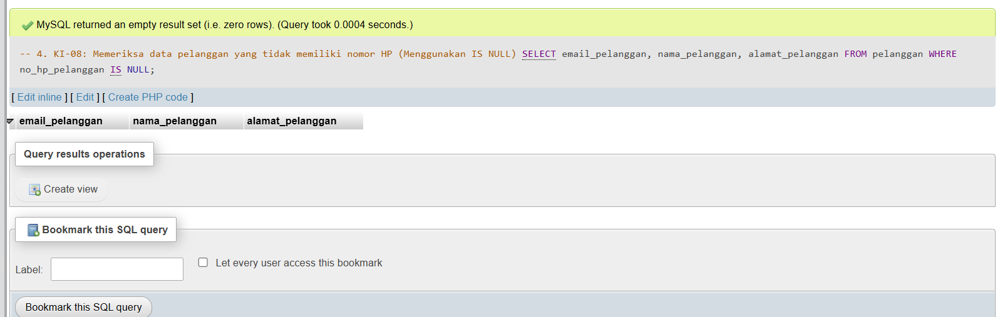
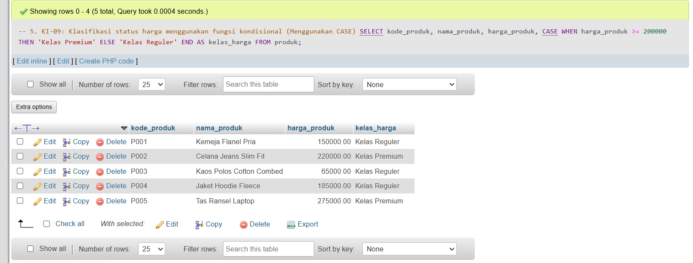

# Laporan Praktikum Basis Data - Pertemuan 07
**Nama:** M. Ardi Faghfirli  
**NIM:** 25430070  
**Kelas:** C  
**Tanggal:** 10 November 2026  

---

## 1. Tujuan Praktikum
1. Menulis kueri `SELECT` dengan proyeksi kolom, alias, dan `DISTINCT`.
2. Menyaring baris data menggunakan operator pembanding, logika, `BETWEEN`, `IN`, `LIKE`, dan `IS NULL`.
3. Mengurutkan serta membatasi hasil keluaran kueri menggunakan `ORDER BY` dan `LIMIT`.
4. Menerapkan fungsi skalar (string, tanggal, numerik, dan kondisional) untuk menyajikan informasi sesuai kebutuhan analitis toko daring (`toko_vardx`).

---

## 2. Ringkasan Dasar Teori
- **Urutan Evaluasi Logis `SELECT`:** Pernyataan ditulis dengan urutan `SELECT` - `FROM` - `WHERE` - `ORDER BY` - `LIMIT`, namun dievaluasi secara logis mulai dari `FROM`, `WHERE`, `SELECT`, `ORDER BY`, hingga `LIMIT`. Hal ini menyebabkan alias yang dibuat pada klausa `SELECT` tidak dapat dikenali di dalam klausa `WHERE`.
- **Fungsi Skalar:** Digunakan untuk memanipulasi data per baris, seperti penggabungan teks (`CONCAT`), penanganan nilai kosong (`IFNULL`), serta percabangan logika (`CASE`).

---

## 3. Hasil Langkah Percobaan
Berikut adalah hasil eksekusi kueri satu tabel pada basis data `toko_vardx`:

### A. Penyaringan Produk Berdasarkan Rentang Harga (`BETWEEN`)
Menampilkan produk yang harganya berada di rentang Rp10.000 hingga Rp100.000 disortir dari harga termurah.

```sql
SELECT kode_produk, nama_produk, harga_produk, stok_produk
FROM produk
WHERE harga_produk BETWEEN 10000 AND 100000
ORDER BY harga_produk ASC;
```


*Gambar 3.1: Bukti hasil eksekusi kueri penyaringan harga dengan BETWEEN pada phpMyAdmin.*

---

### B. Format String dan Penanganan Nilai Kosong (`CONCAT` & `IFNULL`)
Menggabungkan nama dan email pelanggan serta menangani nomor HP yang bernilai `NULL`.

```sql
SELECT CONCAT(nama_pelanggan, ' (', email_pelanggan, ')') AS info_pelanggan,
       IFNULL(no_hp_pelanggan, 'Tidak ada nomor') AS kontak,
       alamat_pelanggan
FROM pelanggan
LIMIT 5;
```


*Gambar 3.2: Bukti hasil eksekusi kueri pemformatan string dan IFNULL pada phpMyAdmin.*

---

## 4. Jawaban Titik Analisis

- **Titik Analisis 1:**  
  *Mengapa alias kolom yang didefinisikan di klausa `SELECT` tidak bisa digunakan di klausa `WHERE`?*  
  **Jawaban:** Hal ini terjadi karena urutan evaluasi logis MariaDB/MySQL mengeksekusi klausa `FROM` dan `WHERE` terlebih dahulu sebelum klausa `SELECT`. Karena `WHERE` dievaluasi lebih awal, MariaDB belum mengenali nama alias baru yang didefinisikan pada klausa `SELECT`.

- **Titik Analisis 2:**  
  *Apa perbedaan perbandingan `NULL` menggunakan operator `=` ketimbang `IS NULL`, serta perbedaan `NULL` dengan string kosong `''`?*  
  **Jawaban:** Perbandingan menggunakan `=` dengan `NULL` (misal: `no_hp = NULL`) akan selalu menghasilkan nilai `UNKNOWN` (false), sehingga harus menggunakan `IS NULL`. `NULL` menandakan bahwa data tersebut memang belum ada atau tidak diketahui (absent/missing value), sedangkan string kosong `''` menandakan data sudah diisi namun bernilai teks hampa dengan panjang karakter 0.

- **Titik Analisis 3:**  
  *Mengapa subtotal per baris dapat dihitung pada modul ini, namun total keseluruhan nota memerlukan fungsi agregat di pertemuan berikutnya?*  
  **Jawaban:** Perhitungan subtotal per baris (seperti `harga * jumlah`) dilakukan menggunakan operasi aritmatika antar kolom dalam satu baris data yang sama (fungsi skalar/per-baris). Sedangkan untuk menghitung total keseluruhan nota, kita perlu menjumlahkan nilai dari banyak baris sekaligus (seperti `SUM()`), yang membutuhkan fungsi agregat pada pemrosesan kelompok data.

---

## 5. Hasil Latihan dan Modifikasi
Pengujian fungsi kondisional `CASE` untuk mengelompokkan kelas harga produk:

```sql
SELECT kode_produk, nama_produk, harga_produk,
       CASE 
           WHEN harga_produk >= 200000 THEN 'Kelas Premium'
           ELSE 'Kelas Reguler'
       END AS kelas_harga
FROM produk;
```


*Gambar 5.1: Hasil eksekusi kueri pengelompokan kelas harga produk.*

---

## 6. Tugas Mandiri: Milestone Proyek 7
- **Berkas Kueri:** Berkas `p07_kueri_25430070.sql` telah disusun berisi kueri-kueri `SELECT` satu tabel yang menyesuaikan struktur riil basis data `toko_vardx`.

---

## 7. Pembahasan dan Kendala
- **Pembahasan:** Seluruh kueri penyaringan, pemformatan string, penanganan `NULL`, dan fungsi kondisional telah disesuaikan dengan struktur tabel `produk` dan `pelanggan` pada basis data `toko_vardx`.
- **Kendala & Solusi:** Terjadi error `#1054 Unknown column` akibat beberapa kolom (seperti `stok_min_produk` dan `tgl_daftar_pelanggan`) yang tidak tersedia pada struktur tabel riil. Kendala ini diselesaikan dengan menyesuaikan kueri menggunakan kolom yang ada (seperti perhitungan stok fisik manual dan penggunaan `IFNULL` untuk kontak).

---

## 8. Kesimpulan
Modul 7 berhasil diselesaikan dengan menguasai penggunaan klausa penyaringan data (`WHERE`, `BETWEEN`, `LIKE`, `IS NULL`), pemformatan string (`CONCAT`), fungsi kondisional (`CASE`, `IFNULL`), serta pemahaman mendalam mengenai urutan evaluasi logis pernyataan `SELECT`.

---

## 9. Pernyataan Penggunaan AI
Saya menyatakan bahwa dalam penyusunan laporan ini, saya menggunakan bantuan alat AI (Gemini) sebagai media diskusi untuk memvalidasi struktur kueri SQL dan format laporan Markdown.

---

## 10. Bukti Git
- **Tautan Repositori:** `https://github.com/MARDIFAGHFIRLI/basis_data`
- **Hash Commit:** `p07: kueri satu tabel dan laporan modul 7`

---

## Checklist
- [x] Berkas `p07_kueri_25430070.sql` ada di repositori
- [x] Tangkapan layar hasil kueri terlampir
- [x] Analisis Titik Analisis 1-3 terjawab
- [x] Commit dan push rutin ke GitHub